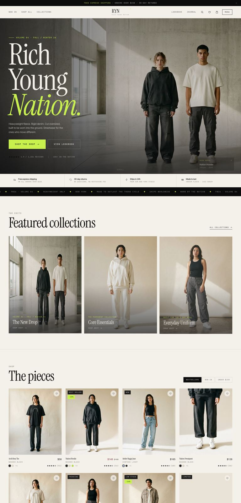
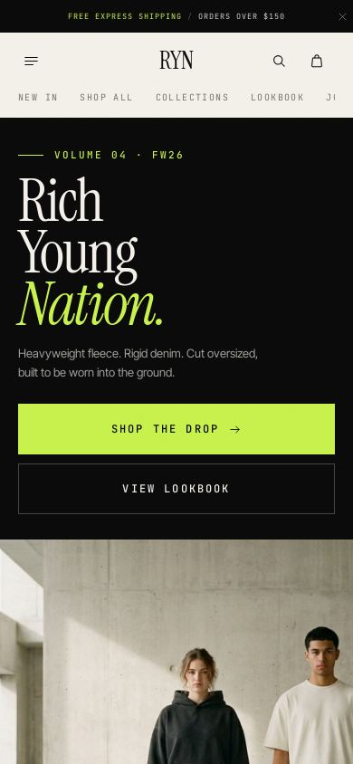
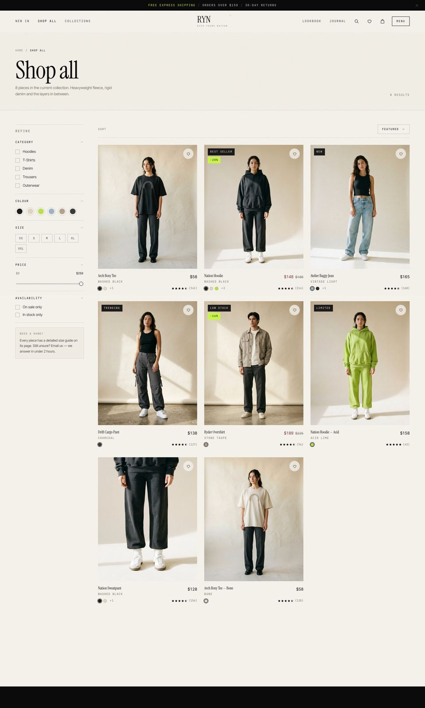
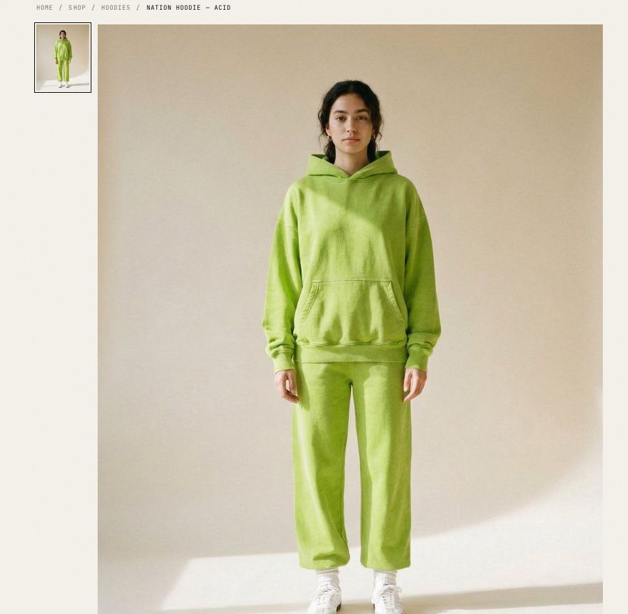
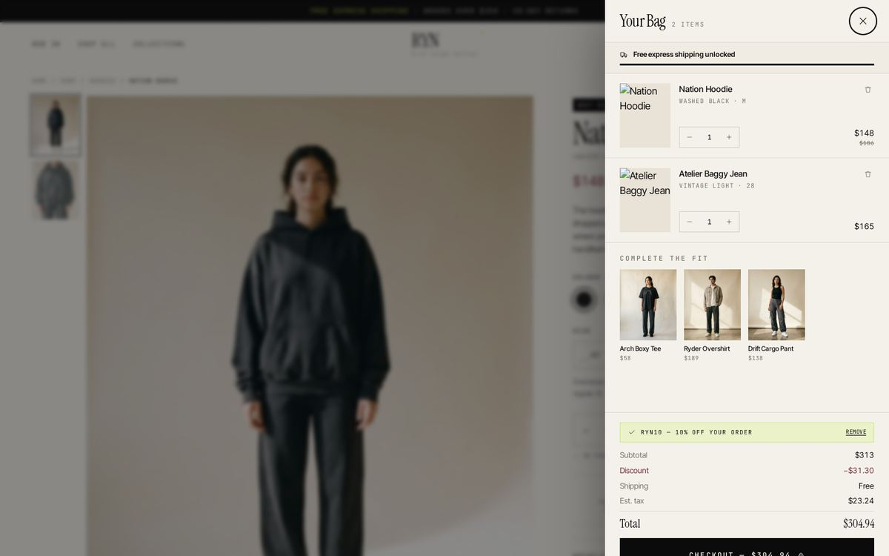
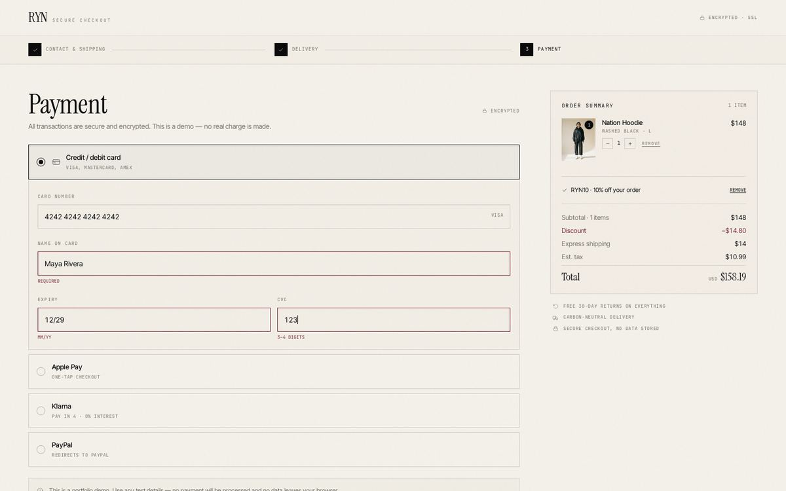
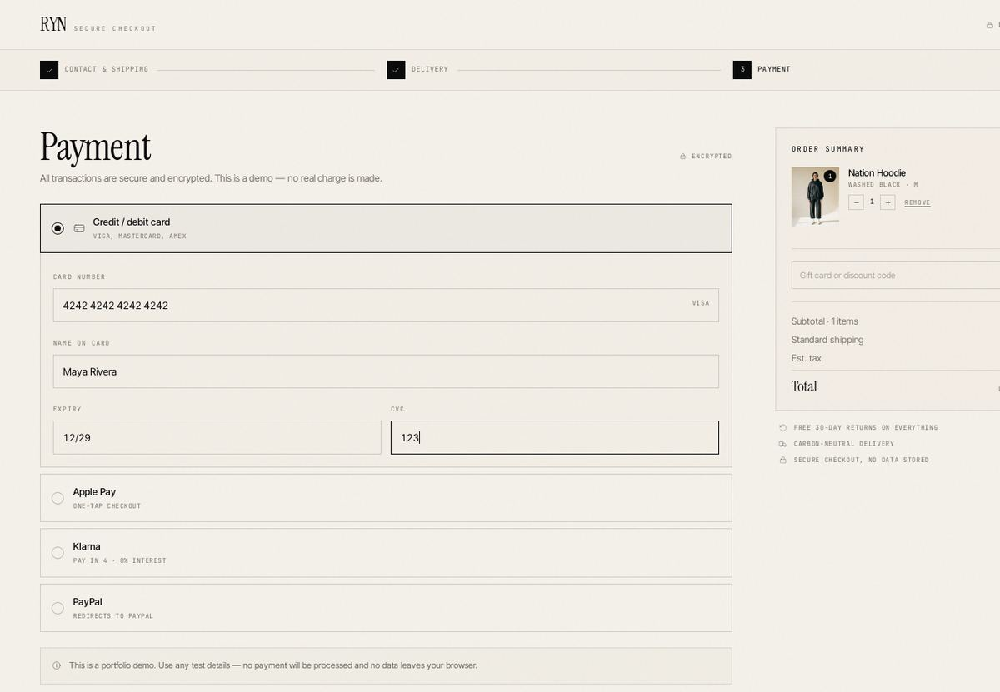
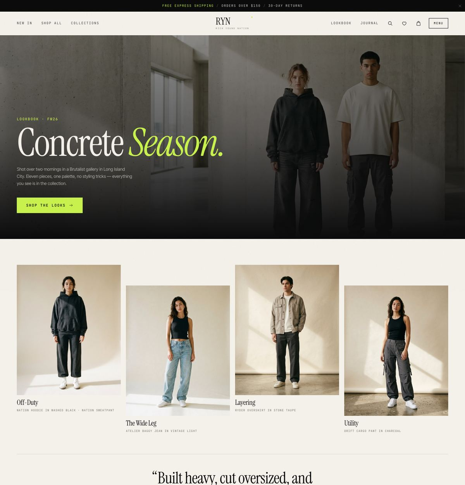

# RYN — Visual preview

A walk through the storefront. Every screen is responsive from 360px up to ultrawide.

---

## Home

Full-bleed editorial hero, featured collections, tabbed product grid and a review wall.

  

---

## Shop

URL-synced filters, six sort modes, active-filter chips and a mobile filter sheet.

---

## Product detail

Colourway-driven gallery with hover zoom and a lightbox, size states, size guide,
rating breakdown and a full review flow.

---

## Cart

A slide-out drawer with a free-shipping meter, promo codes and a cross-sell rail.
Cart state persists across reloads and browser tabs.

---

## Checkout

Three steps — contact, delivery, payment — with inline validation and a sticky
order summary.

---

## Lookbook

